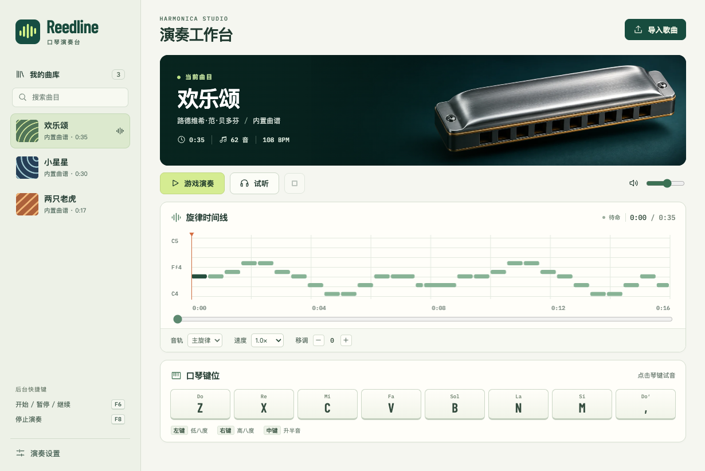

# Reedline · 口琴演奏台

Reedline 是为《三角洲行动》守夜人口琴制作的 Windows 桌面演奏工具。选好歌，把演奏台收进系统托盘，切回游戏就能用快捷键吹奏。曲谱解析、音频转谱和试听均在本机完成。

[下载 Windows x64 版](https://github.com/sh0TTvT/Reedline/releases/latest) · [Windows 构建与测试](https://github.com/sh0TTvT/Reedline/actions/workflows/windows.yml)



## 在游戏中演奏

1. 安装 Release 中的 `windows-x64-setup.exe`，或完整解压便携包，双击 `Reedline.exe`。支持 Windows 10 22H2 / 11 x64。安装版会在系统缺少 WebView2 时联网安装运行时。
2. 从曲库选歌，或点击「导入歌曲」。可先试听，在时间线上定位，调整速度、移调和 MIDI 音轨。默认内置《欢乐颂》《小星星》《两只老虎》。
3. 点击右上方的托盘按钮，或最小化窗口。回到游戏拿起口琴，打开自由演奏界面，按 **F6**。默认倒计时 3 秒，也可以在桌面点击「游戏演奏」后切回游戏。
4. **F6** 暂停或继续，**F8** 停止并回到开头。双击通知区域的绿色图标可打开演奏台。托盘右键菜单也能控制演奏或退出；关闭主窗口会直接退出。

Windows 原生线程用单调时钟安排键盘扫描码和鼠标事件。最小化、网页动画和显示器刷新率都不充当演奏节拍器。开始和继续时会核对前台游戏进程，播放时检查同一窗口。切到其他程序会停止并释放本工具按住的键，切回后可按 F6 从断点继续。工具识别游戏主窗口，游戏里的聊天和背包界面需要自行关闭。

## 可以导入的歌曲

| 文件 | 如何处理 |
| --- | --- |
| MIDI（.mid / .midi） | 支持标准格式 0 和 1，读取变速与 SMPTE 时间。跳过打击乐，分离音轨与通道，自动选择旋律轨，也可手动更换。口琴演奏单声部，重叠音优先保留上方旋律。 |
| UTF-8 数字简谱（.txt） | 支持音高、升降号、八度、休止、延音、速度和小数拍。 |
| 音频（WAV / MP3 / M4A / OGG / FLAC） | 在本地解码并按音高转为旋律。适合单声部清唱、口哨、乐器独奏。复杂伴奏和人声混合时可能选错声部。具体编码取决于系统 WebView2 的解码能力。 |

可以一次导入多个文件，也可以拖入窗口。音频每个文件最多 48 MB / 10 分钟，MIDI 最多 4 MB，简谱最多 1 MB。曲库保存的是解析后的音符，关闭再打开仍可播放，无需保留原文件路径。设置和曲库使用当前 Windows 用户的本地应用数据。

### 简谱示例

```text
曲名=口琴练习
BPM=100
1, 2, 3, 0 | 1 2 #4:0.5 5:0.5 1':2
5 - 3 2 | 1:3 0
```

`1–7` 从 C4 起对应 Do 到 Si，`0` 是休止，`-` 延长一拍。`1,` 降八度，`1'` 升八度，`#4` 升半音，`b3` 降半音，`5:0.5` 占半拍。竖线用于分小节。`1235` 等同于四个一拍音。

## 键位与音域

| 音 | Do | Re | Mi | Fa | Sol | La | Si | 高 Do |
| --- | --- | --- | --- | --- | --- | --- | --- | --- |
| 默认按键 | Z | X | C | V | B | N | M | , |

鼠标左键降八度，右键升八度，中键升半音。所有音键和鼠标修饰键均可重映射。超出音域的音按八度折回。默认使用单鼠标修饰，遇到不可达半音会选邻近音，界面显示适配数量。若当前游戏版本支持双鼠标变调，可在设置中打开「组合半音」。

游戏端收不到输入时，先确认口琴演奏界面位于前台，并核对双方键位和权限级别。Windows 的 SendInput 受进程完整性级别限制。若系统快捷键被占用，界面会标出对应按键，托盘菜单仍可控制。[微软 SendInput 文档](https://learn.microsoft.com/windows/win32/api/winuser/nf-winuser-sendinput)

## 本地开发与验证

前端使用 TypeScript、React、Web Audio 和 Morphicons。Windows 外壳使用 .NET 10 WinForms / WebView2。游戏演奏的时钟与按键释放逻辑在 `native/Reedline/Core/Transport.cs`，和 WebView 独立。

```sh
npm ci
npm test
npm run build
npm run test:ui
dotnet run --project tests/EngineChecks
```

界面测试使用已安装的 Chrome。用 `npm run dev` 可以在浏览器中开发曲库、导入和试听。Windows 安装 .NET 10 SDK 后执行 `dotnet run --project native/Reedline` 打开桌面版。构建安装包还需 Inno Setup 6，在 PowerShell 中执行 `./scripts/package-windows.ps1`。构建产物位于 `artifacts/release`。

Windows 集成测试启动发布后的程序并收进托盘，使用独立的 Win32 接收窗口验证 F6、F8、失焦停止、扫描码、鼠标顺序和实际音符间隔。测试接收程序只参与 CI。真实游戏客户端的输入接收行为需在相应版本中实测。

## 参考项目

- 口琴音区、逗号键与组合半音指法参考 [delta-force-harmonica-tool](https://github.com/2776525655/delta-force-harmonica-tool)。
- 单鼠标变调、音域限制和时序对照参考 [auto_music_player](https://github.com/xiaominaimoyu/auto_music_player)。
- 控件图标由 [Morphicons](https://github.com/guillermolg00/morphicons) 驱动，遵循系统减少动态效果的设置。MIDI 读取使用 [midi-file](https://github.com/carter-thaxton/midi-file)，音频音高检测使用 [Pitchy](https://github.com/ianprime0509/pitchy)。

发行包的 `licenses` 目录包含随附依赖和字体的许可。口琴封面由内置 imagegen 工具制作。[封面原图](public/harmonica.webp)

<details>
<summary>封面生成提示词</summary>

Product-mockup. Wide studio product photograph for the cover panel of a Chinese harmonica music workstation. A single premium unbranded ten-hole diatonic pocket harmonica, brushed silver top cover, graphite hole comb, thin warm brass reed plates. Floating very slightly over a dark midnight petrol teal studio surface with soft contact shadow. Three-quarter top/front view, horizontal long axis tilted a little upward to the right, beautifully legible row of rectangular holes, contained in the right two thirds of the wide cinematic composition, left third is plain near-black teal negative space for separate UI type. Moody directional softbox rim light, finely detailed metal highlights, realistic editorial music-instrument photography. No writing, no logo, no hands, no extra objects, no framing. Wide landscape, ideally 3:1.

</details>
